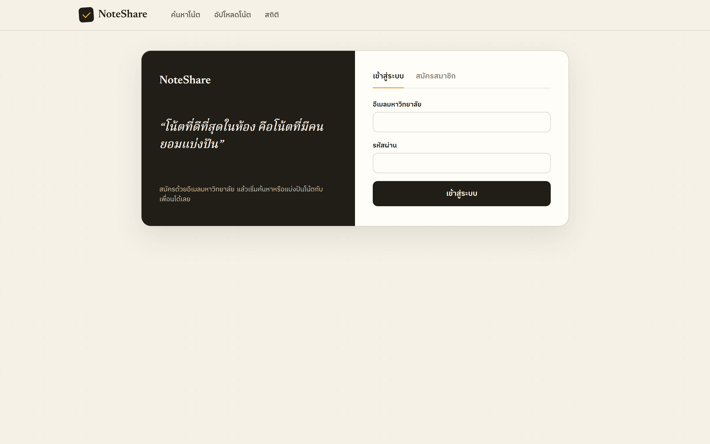
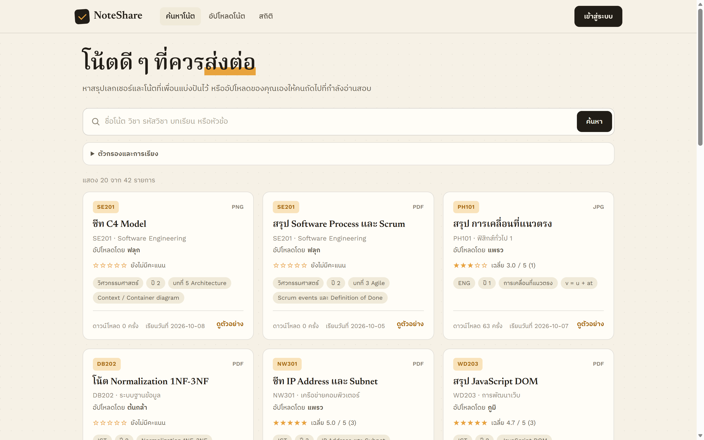
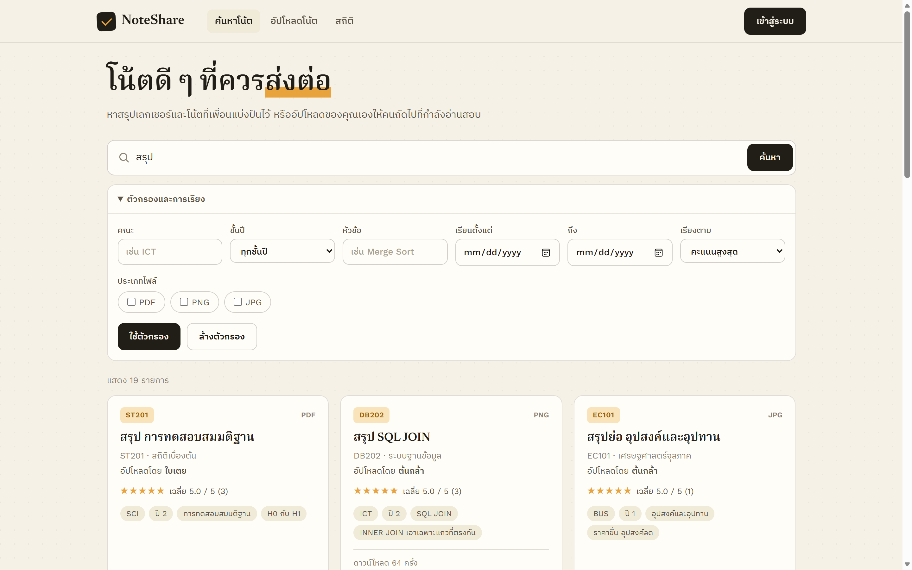
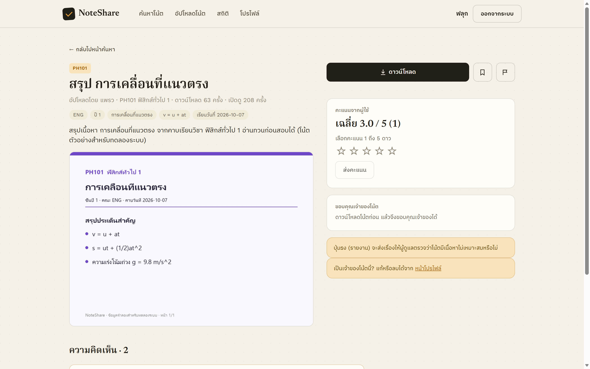
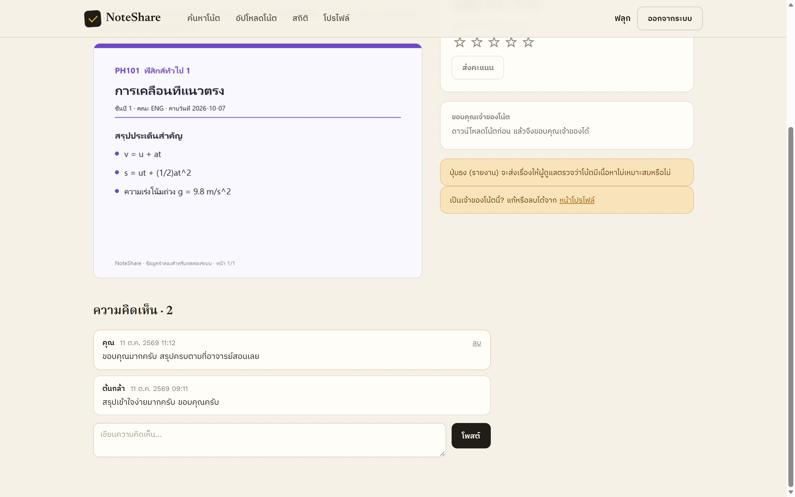
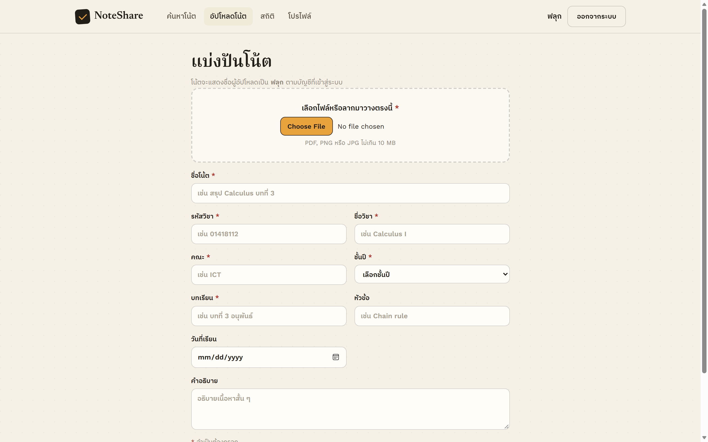
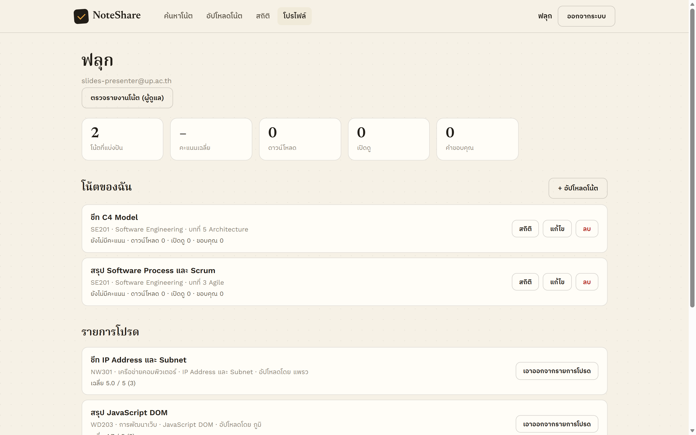
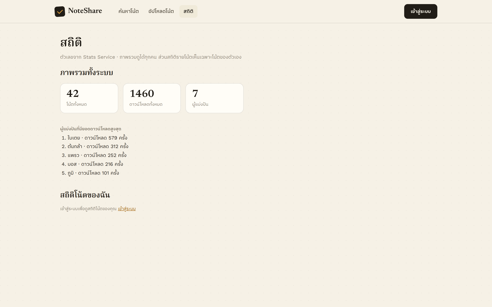
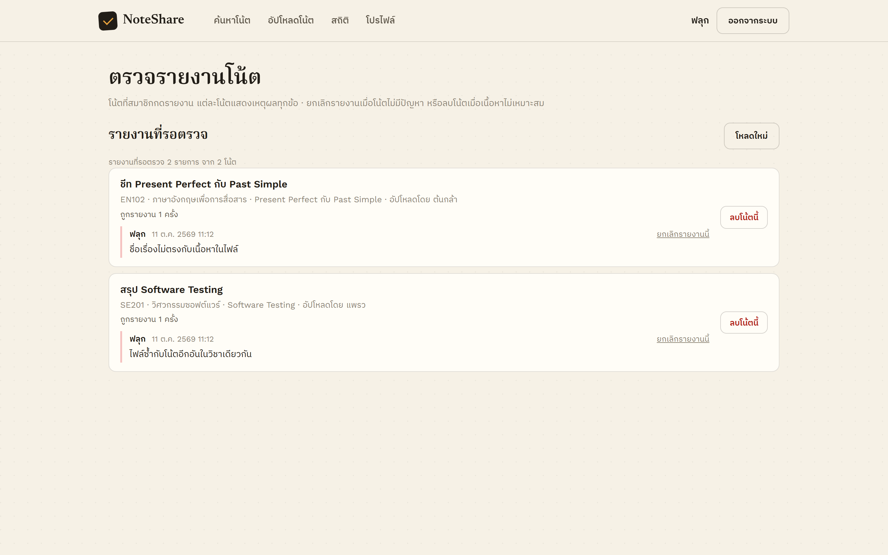

# คู่มือการใช้งาน NoteShare

NoteShare คือเว็บสำหรับแบ่งปันสรุปเลกเชอร์และโน้ตระหว่างนักศึกษา ค้นหาโน้ตของเพื่อน ดูตัวอย่างก่อนโหลด
ให้คะแนน แสดงความคิดเห็น และอัปโหลดโน้ตของตัวเองให้คนอื่นใช้ต่อ

**เปิดใช้งาน:** https://noteshare-sooty.vercel.app

> ภาพหน้าจอในคู่มือนี้ถ่ายจากระบบที่รันบนเครื่องพร้อมข้อมูลจำลอง ชื่อผู้ใช้และตัวเลขในภาพจึงไม่ใช่ข้อมูลจริง

## สารบัญ

1. [ใช้อะไรได้บ้างโดยไม่ต้องเข้าสู่ระบบ](#1-ใช้อะไรได้บ้างโดยไม่ต้องเข้าสู่ระบบ)
2. [สมัครสมาชิกและเข้าสู่ระบบ](#2-สมัครสมาชิกและเข้าสู่ระบบ)
3. [ค้นหาโน้ต](#3-ค้นหาโน้ต)
4. [หน้าโน้ต: ดาวน์โหลด ให้คะแนน และแสดงความคิดเห็น](#4-หน้าโน้ต-ดาวน์โหลด-ให้คะแนน-และแสดงความคิดเห็น)
5. [อัปโหลดโน้ต](#5-อัปโหลดโน้ต)
6. [หน้าโปรไฟล์: แก้ไข ลบ และรายการโปรด](#6-หน้าโปรไฟล์-แก้ไข-ลบ-และรายการโปรด)
7. [หน้าสถิติ](#7-หน้าสถิติ)
8. [สำหรับผู้ดูแลระบบ: ตรวจรายงานโน้ต](#8-สำหรับผู้ดูแลระบบ-ตรวจรายงานโน้ต)
9. [คำถามที่พบบ่อยและข้อความแจ้งเตือน](#9-คำถามที่พบบ่อยและข้อความแจ้งเตือน)

---

## 1. ใช้อะไรได้บ้างโดยไม่ต้องเข้าสู่ระบบ

| ทำได้เลย ไม่ต้องเข้าสู่ระบบ | ต้องเข้าสู่ระบบก่อน |
|---|---|
| ค้นหาและกรองโน้ต | อัปโหลดโน้ต |
| ดูตัวอย่างและดาวน์โหลดไฟล์ | ให้คะแนน |
| อ่านคะแนนและความคิดเห็น | แสดงความคิดเห็น |
| ดูสถิติภาพรวมทั้งระบบ | บันทึกเป็นรายการโปรด |
| | รายงานโน้ตที่ไม่เหมาะสม |
| | ขอบคุณเจ้าของโน้ต |
| | ดูโปรไฟล์ แก้ไขหรือลบโน้ตของตัวเอง และดูสถิติโน้ตของตัวเอง |

ถ้าเปิดหน้าที่ต้องเข้าสู่ระบบ (อัปโหลด โปรไฟล์ ผู้ดูแล) ระบบจะพาไปหน้าเข้าสู่ระบบก่อน
แล้วพากลับมาหน้าเดิมเมื่อเข้าสู่ระบบสำเร็จ

## 2. สมัครสมาชิกและเข้าสู่ระบบ

กดปุ่ม **เข้าสู่ระบบ** มุมขวาบนของทุกหน้า

### สมัครสมาชิก

1. เลือกแท็บ **สมัครสมาชิก**
2. กรอก **ชื่อที่แสดงบนโน้ต** (ไม่เกิน 120 ตัวอักษร) ชื่อนี้จะแสดงบนโน้ตทุกอันที่คุณอัปโหลดและบนความคิดเห็นของคุณ
3. กรอก **อีเมลมหาวิทยาลัย** ต้องลงท้ายด้วย `@up.ac.th` เช่น `67000000@up.ac.th`
4. ตั้ง **รหัสผ่าน** ยาว 8–128 ตัวอักษร
5. กดสมัคร ระบบจะเข้าสู่ระบบให้ทันที

> ตอนนี้ยังเปลี่ยนชื่อที่แสดงหรือรหัสผ่านภายหลังไม่ได้ และยังไม่มีระบบกู้รหัสผ่าน จึงควรจดรหัสผ่านไว้ให้ดี

### เข้าสู่ระบบ

กรอกอีเมลและรหัสผ่านในแท็บ **เข้าสู่ระบบ** แล้วกดปุ่ม **เข้าสู่ระบบ**

- ถ้ากรอกผิด ระบบจะแจ้งว่า "อีเมลหรือรหัสผ่านไม่ถูกต้อง" โดยไม่บอกว่าผิดช่องไหน เพื่อความปลอดภัย
- ถ้ากรอกผิด **5 ครั้งภายใน 15 นาที** บัญชีนั้นจะถูกล็อกชั่วคราว ต้องรอตามเวลาที่ระบบแจ้งก่อนลองใหม่
- การเข้าสู่ระบบอยู่ได้นาน **8 ชั่วโมง** และผูกกับ**แท็บเบราว์เซอร์ที่ใช้อยู่** ถ้าปิดแท็บหรือเปิดแท็บใหม่ต้องเข้าสู่ระบบอีกครั้ง
- กด **ออกจากระบบ** มุมขวาบนเมื่อใช้งานเสร็จ โดยเฉพาะบนเครื่องสาธารณะ

## 3. ค้นหาโน้ต

หน้าแรกคือหน้าค้นหา ระบบแสดงโน้ตล่าสุดให้ดูทันที

### ค้นหาด้วยคำ

พิมพ์คำในช่องค้นหาแล้วกด **ค้นหา** หรือ Enter ระบบจะหาคำนั้นจาก **ชื่อโน้ต ชื่อวิชา รหัสวิชา บทเรียน และหัวข้อ**
พิมพ์แค่บางส่วนก็เจอ และตัวพิมพ์เล็กหรือใหญ่ให้ผลเหมือนกัน (คำอธิบายและชื่อผู้อัปโหลดไม่ถูกนำมาค้น)

### ตัวกรองและการเรียง

กด **ตัวกรองและการเรียง** เพื่อเปิดตัวเลือกเพิ่ม

| ตัวเลือก | ทำอะไร |
|---|---|
| คณะ | แสดงเฉพาะโน้ตของคณะที่ระบุ (ต้องพิมพ์ให้ตรง เช่น `ICT`) |
| ชั้นปี | เลือกชั้นปี 1–8 หรือ "ทุกชั้นปี" |
| หัวข้อ | หาจากช่องหัวข้อของโน้ต พิมพ์บางส่วนก็ได้ |
| เรียนตั้งแต่ / ถึง | แสดงเฉพาะโน้ตที่มีวันที่เรียนอยู่ในช่วงนี้ (โน้ตที่ไม่ได้ใส่วันที่เรียนจะไม่แสดง) |
| ประเภทไฟล์ | ติ๊ก PDF, PNG, JPG ได้หลายอัน |
| เรียงตาม | อัปโหลดล่าสุด (ค่าเริ่มต้น), อัปโหลดเก่าสุด, วันที่เรียนล่าสุด, ชื่อโน้ต ก-ฮ / A-Z, คะแนนสูงสุด |

- ช่องที่ต้องพิมพ์ (คณะ หัวข้อ) ต้องกด **ใช้ตัวกรอง** หรือ Enter ส่วนตัวเลือกอื่นค้นหาให้ทันทีที่เปลี่ยน
- กด **ล้างตัวกรอง** เพื่อกลับไปค่าเริ่มต้น
- ผลลัพธ์แสดงทีละ 20 รายการ กด **โหลดเพิ่ม** ท้ายหน้าเพื่อดูต่อ
- เงื่อนไขการค้นหาอยู่ใน URL กดรีเฟรชหรือย้อนกลับแล้วผลยังอยู่ และคัดลอกลิงก์ส่งให้เพื่อนได้

### การ์ดโน้ตและดูตัวอย่างแบบเร็ว

การ์ดแต่ละใบบอกรหัสวิชา ชนิดไฟล์ ชื่อโน้ต ผู้อัปโหลด คะแนนเฉลี่ย แท็ก จำนวนดาวน์โหลด และวันที่เรียน

- กด**ชื่อโน้ต**เพื่อเปิดหน้าโน้ต
- กด **ดูตัวอย่าง** เพื่อดูภาพตัวอย่างโดยไม่ต้องออกจากหน้าค้นหา ในกล่องนี้กด **เปิดหน้าโน้ต** หรือ **ดาวน์โหลดไฟล์เต็ม** ได้

## 4. หน้าโน้ต: ดาวน์โหลด ให้คะแนน และแสดงความคิดเห็น

ส่วนบนของหน้าแสดงชื่อโน้ต ผู้อัปโหลด วิชา จำนวนดาวน์โหลดและจำนวนเปิดดู แท็ก และคำอธิบาย
ถัดลงมาเป็น**ภาพตัวอย่าง** ไฟล์ PDF แสดงหน้าแรก ส่วนไฟล์ภาพแสดงทั้งภาพ

### ปุ่มด้านขวา

| ปุ่ม | ทำอะไร | ต้องเข้าสู่ระบบ |
|---|---|---|
| **ดาวน์โหลด** | โหลดไฟล์เต็ม | ไม่ต้อง |
| ไอคอนที่คั่นหนังสือ (บันทึกเป็นรายการโปรด) | เพิ่มหรือเอาออกจากรายการโปรด ดูรายการได้ที่หน้าโปรไฟล์ | ต้อง |
| ไอคอนธง (รายงานโน้ตนี้) | แจ้งผู้ดูแลว่าโน้ตมีเนื้อหาไม่เหมาะสม | ต้อง |

### ให้คะแนน

เลือก 1–5 ดาวในกล่อง **คะแนนจากผู้ใช้** แล้วกด **ส่งคะแนน**
แต่ละคนให้คะแนนโน้ตหนึ่งอันได้หนึ่งคะแนน และกลับมาเปลี่ยนได้ทุกเมื่อ

### ขอบคุณเจ้าของโน้ต

ถ้าโน้ตช่วยคุณได้ ส่งคำขอบคุณให้เจ้าของได้

1. เข้าสู่ระบบ
2. กด **ดาวน์โหลด** ในหน้าโน้ต (การดาวน์โหลดจากกล่องดูตัวอย่างในหน้าค้นหาจะไม่ทำให้ปุ่มขึ้น)
3. ปุ่ม **🙏 ขอบคุณ** จะปรากฏ กดได้ **ครั้งเดียวต่อโน้ต** และยกเลิกไม่ได้

ขอบคุณโน้ตของตัวเองไม่ได้ เจ้าของโน้ตดูจำนวนคำขอบคุณได้ที่หน้าโปรไฟล์และหน้าสถิติ

### รายงานโน้ต

กดไอคอนธงข้างปุ่มดาวน์โหลด พิมพ์เหตุผล (ไม่เกิน 500 ตัวอักษร) เช่น "เนื้อหาไม่ตรงกับชื่อ" หรือ "มีข้อมูลส่วนตัวของคนอื่น"
แล้วกด **ส่งรายงาน** แต่ละคนรายงานโน้ตหนึ่งอันได้ครั้งเดียว ผู้ดูแลจะเป็นผู้ตัดสินว่าจะลบโน้ตหรือไม่

### ความคิดเห็น

- ทุกคนอ่านความคิดเห็นได้ ความคิดเห็นใหม่สุดอยู่บนสุด
- เข้าสู่ระบบแล้วพิมพ์ในช่อง **เขียนความคิดเห็น...** (ไม่เกิน 1,000 ตัวอักษร) แล้วกด **โพสต์**
- ความคิดเห็นของคุณจะแสดงชื่อว่า **คุณ** และมีปุ่ม **ลบ** ลบได้เฉพาะความคิดเห็นของตัวเองเท่านั้น

## 5. อัปโหลดโน้ต

กดเมนู **อัปโหลดโน้ต** ด้านบน (ต้องเข้าสู่ระบบ)

1. **เลือกไฟล์** หรือลากไฟล์มาวางในกรอบ รองรับ **PDF, PNG, JPG** ขนาด**ไม่เกิน 10 MB**
2. กรอกช่องที่มีเครื่องหมาย * ให้ครบ

   | ช่อง | จำเป็น | หมายเหตุ |
   |---|---|---|
   | ชื่อโน้ต | ✓ | ไม่เกิน 200 ตัวอักษร |
   | รหัสวิชา | ✓ | ไม่เกิน 30 ตัวอักษร |
   | ชื่อวิชา | ✓ | ไม่เกิน 200 ตัวอักษร |
   | คณะ | ✓ | ไม่เกิน 100 ตัวอักษร |
   | ชั้นปี | ✓ | เลือก 1–8 |
   | บทเรียน | ✓ | ไม่เกิน 200 ตัวอักษร |
   | หัวข้อ | | ไม่เกิน 200 ตัวอักษร ช่วยให้ค้นเจอง่ายขึ้น |
   | วันที่เรียน | | ใช้กับตัวกรองช่วงวันที่และการเรียงตามวันที่เรียน |
   | คำอธิบาย | | อธิบายเนื้อหาสั้น ๆ |

3. กดปุ่ม **อัปโหลด ✓** ระหว่างส่งไฟล์จะมีแถบบอกความคืบหน้า
4. เมื่อขึ้น **อัปโหลดสำเร็จ** โน้ตจะแสดงในหน้าค้นหาทันที กด **ดูในหน้าค้นหา** เพื่อเปิดดู หรือ **อัปโหลดอีกไฟล์**

ชื่อผู้อัปโหลดมาจากบัญชีที่เข้าสู่ระบบอยู่เสมอ ถ้าช่องไหนกรอกผิด ฟอร์มจะชี้ให้เห็นก่อนส่งไฟล์

## 6. หน้าโปรไฟล์: แก้ไข ลบ และรายการโปรด

กดเมนู **โปรไฟล์** (แสดงเมื่อเข้าสู่ระบบแล้ว)

ด้านบนแสดงชื่อ อีเมล และตัวเลขสรุปของโน้ตทั้งหมดที่คุณแบ่งปัน ได้แก่ จำนวนโน้ต คะแนนเฉลี่ย ดาวน์โหลด เปิดดู และคำขอบคุณ

### โน้ตของฉัน

โน้ตแต่ละอันมี 3 ปุ่ม

- **สถิติ** เปิดหน้าสถิติของโน้ตนั้น (เปิดดู ดาวน์โหลด ขอบคุณ)
- **แก้ไข** แก้ข้อมูลโน้ตได้ทุกช่องเหมือนตอนอัปโหลด แต่**เปลี่ยนไฟล์ไม่ได้** ถ้าต้องการเปลี่ยนไฟล์ให้ลบแล้วอัปโหลดใหม่
- **ลบ** ระบบจะถามยืนยันก่อน การลบจะลบไฟล์ คะแนน ความคิดเห็น และคำขอบคุณของโน้ตนั้นทั้งหมด **ย้อนกลับไม่ได้**

ปุ่ม **+ อัปโหลดโน้ต** พาไปหน้าอัปโหลด

### รายการโปรด

แสดงโน้ตที่คุณกดบันทึกไว้ ล่าสุดอยู่บนสุด กดชื่อเพื่อเปิดโน้ต หรือกด **เอาออกจากรายการโปรด**

## 7. หน้าสถิติ

กดเมนู **สถิติ**

- **ภาพรวมทั้งระบบ** (ทุกคนดูได้) แสดงจำนวนโน้ตทั้งหมด ดาวน์โหลดทั้งหมด จำนวนผู้แบ่งปัน และ 5 อันดับผู้แบ่งปันที่มียอดดาวน์โหลดสูงสุด
  ถ้าเข้าสู่ระบบแล้ว จะเห็นอันดับของตัวเองด้วย
- **สถิติโน้ตของฉัน** (ต้องเข้าสู่ระบบ) แสดงจำนวนเปิดดู ดาวน์โหลด และคำขอบคุณของโน้ตแต่ละอันที่คุณอัปโหลด
  ดูได้เฉพาะโน้ตของตัวเอง

ยอดเปิดดูนับทุกครั้งที่เปิดหน้าโน้ตหรือกล่องดูตัวอย่าง ยอดดาวน์โหลดนับทุกครั้งที่ดาวน์โหลดสำเร็จ ส่วนการดูภาพตัวอย่างไม่นับเป็นการดาวน์โหลด

## 8. สำหรับผู้ดูแลระบบ: ตรวจรายงานโน้ต

ผู้ดูแลคือบัญชีที่ทีมพัฒนาตั้งสิทธิ์ไว้ในระบบ บัญชีผู้ดูแลจะเห็นปุ่ม **ตรวจรายงานโน้ต (ผู้ดูแล)** ในหน้าโปรไฟล์

- รายงานถูกจัดกลุ่มตามโน้ต บอกจำนวนครั้งที่ถูกรายงาน ชื่อผู้รายงาน เวลา และเหตุผล
- **ยกเลิกรายงานนี้** ใช้เมื่อตรวจแล้วโน้ตไม่มีปัญหา รายงานนั้นจะหายไปแต่โน้ตยังอยู่
- **ลบโน้ตนี้** ใช้เมื่อเนื้อหาไม่เหมาะสม ระบบจะถามยืนยันก่อน แล้วลบโน้ตพร้อมไฟล์และรายงานทั้งหมด ย้อนกลับไม่ได้
- กด **โหลดใหม่** เพื่อดูรายงานล่าสุด

บัญชีที่ไม่ใช่ผู้ดูแลจะเปิดหน้านี้ไม่ได้

## 9. คำถามที่พบบ่อยและข้อความแจ้งเตือน

**สมัครด้วย Gmail ได้ไหม**
ไม่ได้ ต้องใช้อีเมล `@up.ac.th` เท่านั้น

**ทำไมเปิดแท็บใหม่แล้วต้องเข้าสู่ระบบอีก**
การเข้าสู่ระบบผูกกับแท็บที่ใช้อยู่ และหมดอายุใน 8 ชั่วโมง เพื่อลดความเสี่ยงเมื่อใช้เครื่องร่วมกับคนอื่น

**ทำไมไม่เห็นปุ่มขอบคุณ**
ต้องเข้าสู่ระบบ แล้วกดดาวน์โหลดจากหน้าโน้ตในแท็บเดียวกันก่อน และต้องไม่ใช่โน้ตของตัวเอง

**อยากเปลี่ยนไฟล์ของโน้ตที่อัปโหลดไปแล้ว**
ลบโน้ตเดิมในหน้าโปรไฟล์แล้วอัปโหลดใหม่ (คะแนน ความคิดเห็น และคำขอบคุณของโน้ตเดิมจะหายไปด้วย)

**เว็บโหลดช้าตอนเปิดครั้งแรก**
ครั้งแรกหลังจากไม่มีคนใช้สักพัก ระบบอาจใช้เวลาเริ่มทำงานไม่กี่วินาที ครั้งต่อไปจะเร็วขึ้น

| ข้อความ | ความหมายและวิธีแก้ |
|---|---|
| ต้องใช้อีเมลของมหาวิทยาลัย (@up.ac.th) | ใช้อีเมลมหาวิทยาลัยในการสมัคร |
| อีเมลนี้สมัครสมาชิกไว้แล้ว ลองเข้าสู่ระบบแทน | บัญชีมีอยู่แล้ว ไปที่แท็บเข้าสู่ระบบ |
| อีเมลหรือรหัสผ่านไม่ถูกต้อง | ตรวจอีเมลและรหัสผ่านอีกครั้ง |
| เข้าสู่ระบบไม่สำเร็จหลายครั้งเกินไป กรุณาลองใหม่ในอีก N นาที | รอตามเวลาที่แจ้งแล้วลองใหม่ |
| เซสชันหมดอายุหรือออกจากระบบไปแล้ว กรุณาเข้าสู่ระบบใหม่ | ครบ 8 ชั่วโมงหรือออกจากระบบไปแล้ว ให้เข้าสู่ระบบใหม่ |
| รองรับเฉพาะไฟล์ PDF, PNG และ JPG | เปลี่ยนเป็นไฟล์ชนิดที่รองรับ |
| ไฟล์ใหญ่เกิน 10 MB | ลดขนาดไฟล์ เช่น บีบอัด PDF หรือลดความละเอียดภาพ |
| โน้ตนี้สร้างภาพตัวอย่างไม่ได้ ลองดาวน์โหลดไฟล์เต็มแทน | ไฟล์ยังโหลดได้ตามปกติ แค่สร้างภาพตัวอย่างไม่ได้ |
| ไม่พบโน้ตที่ตรงกับเงื่อนไข | ลองใช้คำค้นที่สั้นลงหรือกด ล้างตัวกรอง |
| คุณรายงานโน้ตนี้ไปแล้ว ผู้ดูแลจะตรวจสอบให้ | รายงานซ้ำไม่ได้ รอผู้ดูแลตรวจ |
