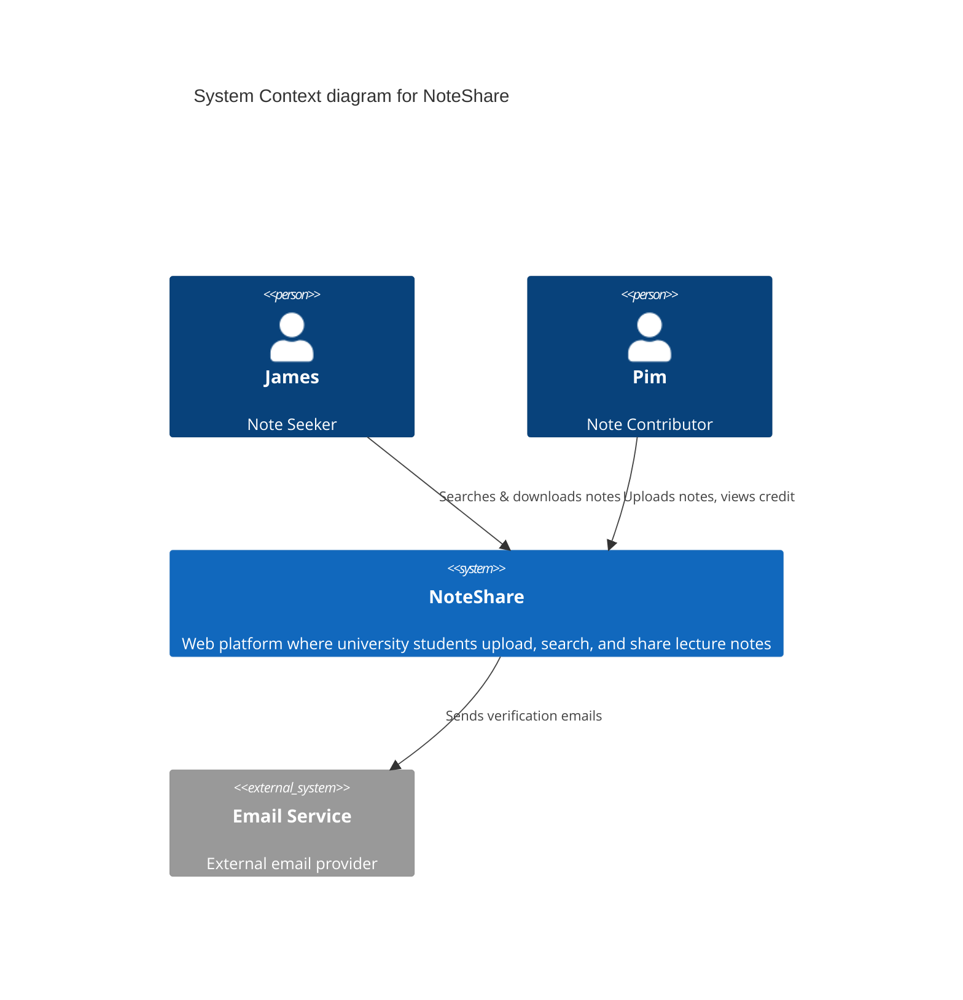
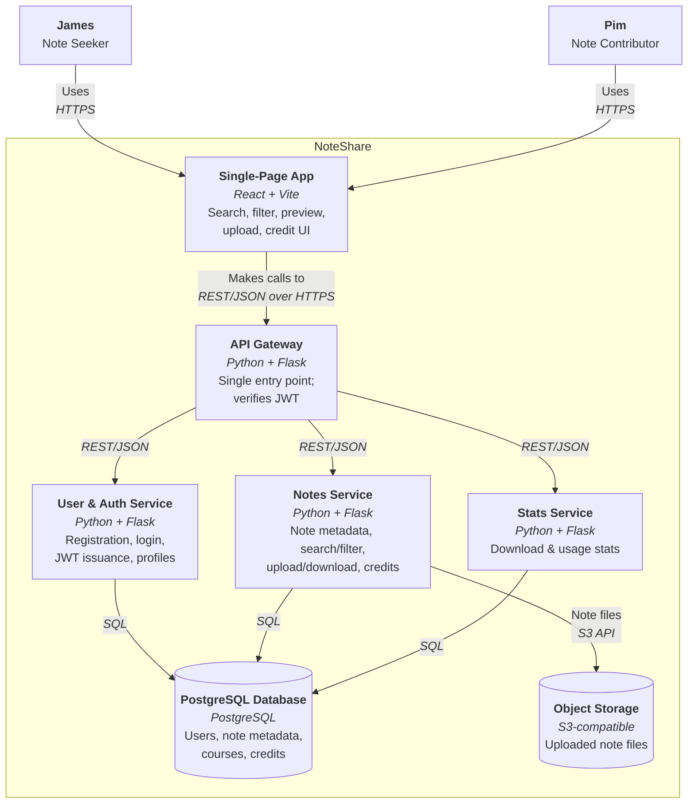

# NoteShare — Architecture

🌐 **English** · [ภาษาไทย](./README.th.md)

The architectural blueprint for **NoteShare**, a web platform where university students upload, search, and share lecture notes. We describe the system with the [C4 model](https://c4model.com/) (Level 1 & 2) and record the reasoning behind key decisions as [ADRs](./adr/).

## C4 Level 1 — System Context

Who uses NoteShare and which external systems it depends on.


| Relationship | Description |
| --- | --- |
| James (Note Seeker) → NoteShare | Searches, previews & downloads notes; gives credit to authors |
| Pim (Note Contributor) → NoteShare | Uploads & organizes notes; views recognition/usage of her notes |
| NoteShare → Email Service | Sends account-verification and notification emails |



Mermaid source: [`diagrams/c4-level-1-context.mmd`](diagrams/c4-level-1-context.mmd) · notes in [c4-context.md](./c4-context.md)

## C4 Level 2 — Containers

Zooming into NoteShare: the runnable/deployable units and how they talk to each other.


| Container | Tech | Responsibility |
| --- | --- | --- |
| Single-Page App | React + Vite | All user-facing UI in the browser: search, filter, preview, upload, credit |
| API Gateway | Python + Flask | Single entry point; routes requests to services and verifies tokens (JWT) |
| User & Auth Service | Python + Flask | Registration, login (hashed passwords), JWT issuance, profiles |
| Notes Service | Python + Flask | Note metadata, search/filter, upload/download, credits |
| Stats Service | Python + Flask | Aggregates download and usage stats for contributor recognition |
| PostgreSQL Database | PostgreSQL | Users, note metadata, courses, and credit records |
| Object Storage | S3-compatible | Uploaded note files (PDF/images) |



Mermaid source: [`diagrams/c4-level-2-container.mmd`](diagrams/c4-level-2-container.mmd) · notes in [c4-container.md](./c4-container.md)

## Technology Stack

| Layer | Choice |
| --- | --- |
| Frontend | React (SPA) + Vite |
| Backend | Python + Flask (microservices) |
| Inter-service communication | REST / JSON over HTTP |
| Database | PostgreSQL |
| File storage | S3-compatible object storage |
| Packaging | Docker + Docker Compose |
| Deployment | Backend as containers on a cloud host; frontend on Vercel |

Full rationale and trade-offs are in [ADR-001: Core Technology Stack](./adr/0001-tech-stack-selection.md).

## Architecture Decision Records

- [ADR-001 — Selection of Core Technology Stack](./adr/0001-tech-stack-selection.md)
- [ADR-002 — Use RESTful APIs for Internal Service Communication](./adr/0002-use-restful-api-internal-communication.md)

## Editing the diagrams

Diagrams are authored as Mermaid (`diagrams/*.mmd`) and rendered to SVG + PNG. Each diagram has an English and a Thai version (`*.th.mmd`). Edit the `.mmd`, then re-render both formats with the same basename:

```bash
npx @mermaid-js/mermaid-cli -i diagrams/c4-level-1-context.mmd -o diagrams/c4-level-1-context.svg -b white
npx @mermaid-js/mermaid-cli -i diagrams/c4-level-1-context.mmd -o diagrams/c4-level-1-context.png -w 1600 -b white
```

The Mermaid blocks embedded in this README are the same diagrams, kept in sync with the `.mmd` files so GitHub renders them inline without needing the image files.
