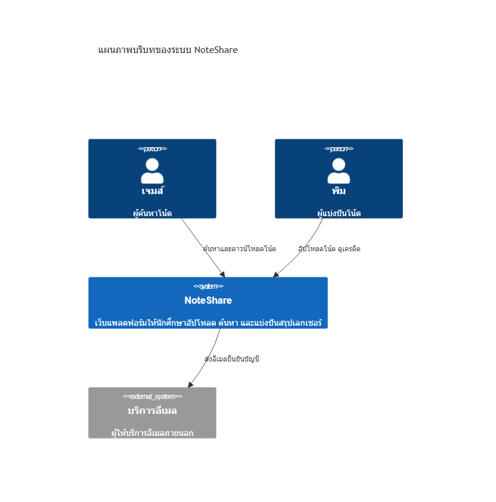
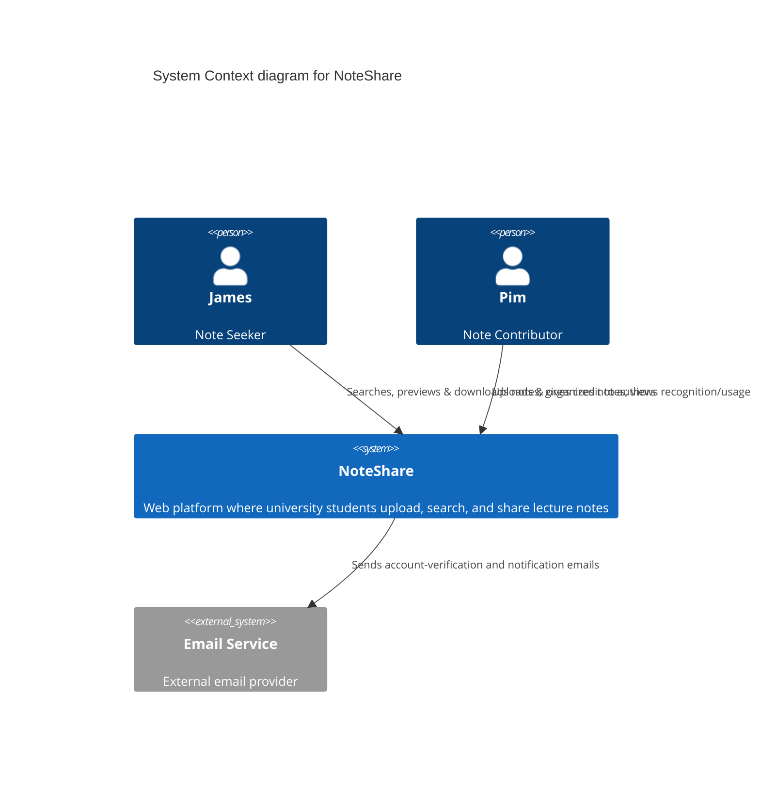
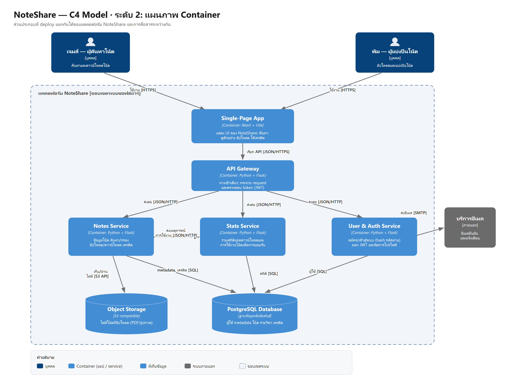
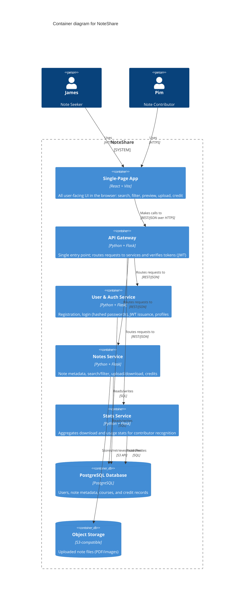

# NoteShare — สถาปัตยกรรม

🌐 [English](./README.md) · **ภาษาไทย**

พิมพ์เขียวทางสถาปัตยกรรมของ **NoteShare** เว็บแพลตฟอร์มให้นักศึกษาอัปโหลด ค้นหา และแบ่งปันสรุปเลกเชอร์
เราอธิบายระบบด้วย [C4 model](https://c4model.com/) (Level 1 และ 2) และบันทึกเหตุผลของการตัดสินใจสำคัญไว้เป็น [ADR](./adr/)

## C4 Level 1 — บริบทของระบบ (System Context)

ภาพรวมว่าใครใช้ NoteShare และระบบไปพึ่งพาบริการภายนอกอะไรบ้าง

| ความสัมพันธ์ | คำอธิบาย |
| --- | --- |
| เจมส์ (ผู้ค้นหาโน้ต) → NoteShare | ค้นหา ดูตัวอย่าง และดาวน์โหลดโน้ต แล้วให้เครดิตเจ้าของโน้ต |
| พิม (ผู้แบ่งปันโน้ต) → NoteShare | อัปโหลดและจัดระเบียบโน้ต ดูการยอมรับ/สถิติการใช้งานโน้ตของตัวเอง |
| NoteShare → บริการอีเมล | ส่งอีเมลยืนยันบัญชีและอีเมลแจ้งเตือน |

ต้นฉบับ Mermaid แก้ไขได้ที่ [c4-context.md](./c4-context.md) (มีเวอร์ชันเดียว ใช้ร่วมกับหน้าอังกฤษ)

## C4 Level 2 — Container

ซูมเข้าไปในระบบ NoteShare เพื่อดูส่วนประกอบที่ deploy แยกกันได้ และการสื่อสารระหว่างกัน

| Container | เทคโนโลยี | หน้าที่ |
| --- | --- | --- |
| Single-Page App | React + Vite | UI ทั้งหมดในเบราว์เซอร์: ค้นหา กรอง ดูตัวอย่าง อัปโหลด และให้เครดิต |
| API Gateway | Python + Flask | ทางเข้าเดียวของระบบ กระจาย request ไปยัง service และตรวจสอบ token (JWT) |
| User & Auth Service | Python + Flask | สมัครสมาชิก เข้าสู่ระบบ (เก็บรหัสผ่านแบบ hash) ออก JWT และจัดการโปรไฟล์ |
| Notes Service | Python + Flask | ข้อมูลโน้ต ค้นหา/กรอง จัดการอัปโหลด–ดาวน์โหลด และเครดิต |
| Stats Service | Python + Flask | รวมสถิติยอดดาวน์โหลดและการใช้งานโน้ต เพื่อการยอมรับของผู้แบ่งปัน |
| PostgreSQL Database | PostgreSQL | เก็บข้อมูลผู้ใช้ metadata ของโน้ต รายวิชา และเครดิต |
| Object Storage | S3-compatible | เก็บไฟล์โน้ตที่อัปโหลด (PDF/รูปภาพ) |

ต้นฉบับ Mermaid แก้ไขได้ที่ [c4-container.md](./c4-container.md) (มีเวอร์ชันเดียว ใช้ร่วมกับหน้าอังกฤษ)

## Technology Stack

| ส่วน | ที่เลือกใช้ |
| --- | --- |
| Frontend | React (SPA) + Vite |
| Backend | Python + Flask (microservices) |
| Inter-service communication | REST / JSON over HTTP |
| Database | PostgreSQL |
| File storage | S3-compatible object storage |
| Packaging | Docker + Docker Compose |
| Deployment | backend รันเป็น container บน cloud host, frontend บน Vercel |

เหตุผลและ trade-off ทั้งหมดอยู่ใน [ADR-001: Core Technology Stack](./adr/0001-tech-stack-selection.th.md)

## Architecture Decision Records

- [ADR-001 — การเลือก Core Technology Stack](./adr/0001-tech-stack-selection.th.md)
- [ADR-002 — ใช้ RESTful API สำหรับการสื่อสารระหว่าง Service](./adr/0002-use-restful-api-internal-communication.th.md)

## แก้ไขแผนภาพ

แผนภาพเขียนเป็นไฟล์ SVG (`diagrams/*.svg`) เป็นต้นฉบับ และ export เป็น `.png` สำหรับแสดงผล
แต่ละแผนภาพมีเวอร์ชันอังกฤษและไทย (`*.th.svg` / `*.th.png`) แก้ที่ไฟล์ `.svg` แล้ว export เป็น PNG ชื่อเดิมทับ
