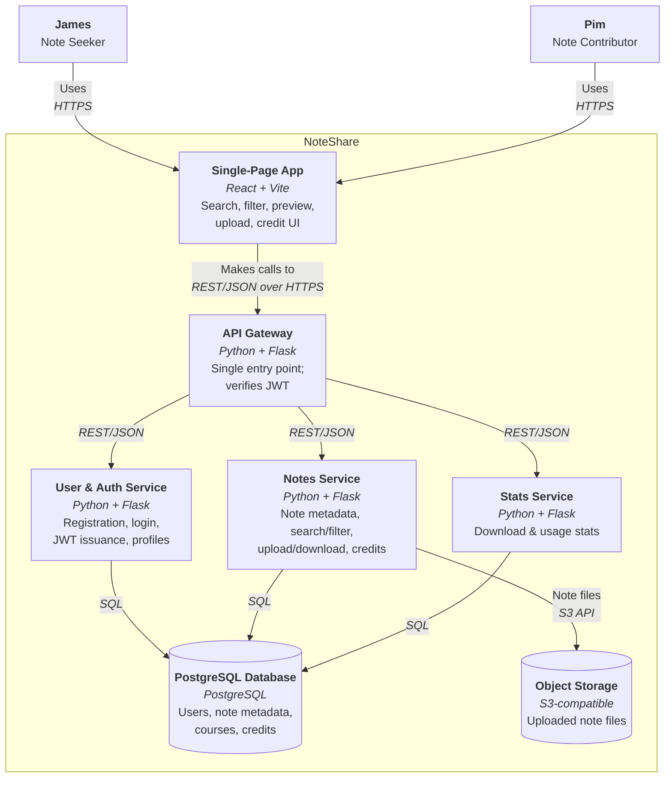

# C4 Level 2 — Containers (Mermaid Source)

แผนภาพ C4 Level 2 (Container) ของ NoteShare ในรูปแบบ Mermaid — container, เทคโนโลยี และ responsibility ทั้งหมดตรงกับตารางใน [README.md](./README.md#c4-level-2--containers) ทุกประการ

ต้นฉบับที่ใช้ render จริงอยู่ที่ [`diagrams/c4-level-2-container.mmd`](diagrams/c4-level-2-container.mmd) (ฉบับไทย: [`.th.mmd`](diagrams/c4-level-2-container.th.mmd)) — ถ้าจะแก้แผนภาพ ให้แก้ที่ไฟล์ `.mmd` แล้ว render รูปใหม่ตามขั้นตอนใน [README.md](./README.md#editing-the-diagrams)

แผนภาพนี้เขียนด้วย `flowchart` ไม่ใช่ `C4Container` เพราะตัว renderer ของ `C4Container` เรียงกล่องทั้ง 7 ต่อกันเป็นแถวตั้งยาวและวางป้ายกำกับเส้นทับกันจนอ่านไม่ออก ส่วน `flowchart` วาง 3 service แตกออกด้านข้างได้ตามที่ต้องการ เนื้อหาที่สื่อยังเป็น Container diagram ตาม C4 เหมือนเดิม (กล่อง = container, มีเทคโนโลยีและหน้าที่กำกับ, มีขอบเขตระบบ, เส้นมีโพรโทคอล)

## Diagram

## Containers (อ้างอิงจาก README.md)

| Container | Tech | Responsibility |
| --- | --- | --- |
| Single-Page App | React + Vite | All user-facing UI in the browser: search, filter, preview, upload, credit |
| API Gateway | Python + Flask | Single entry point; routes requests to services and verifies tokens (JWT) |
| User & Auth Service | Python + Flask | Registration, login (hashed passwords), JWT issuance, profiles |
| Notes Service | Python + Flask | Note metadata, search/filter, upload/download, credits |
| Stats Service | Python + Flask | Aggregates download and usage stats for contributor recognition |
| PostgreSQL Database | PostgreSQL | Users, note metadata, courses, and credit records |
| Object Storage | S3-compatible | Uploaded note files (PDF/images) |

การเรียกทั้งหมดระหว่าง SPA → API Gateway → services เป็น REST/JSON over HTTP (รายละเอียดใน [ADR-002](./adr/0002-use-restful-api-internal-communication.md)) ส่วน service แต่ละตัวคุยกับ PostgreSQL ด้วย SQL ตรง ๆ และ Notes Service เป็นตัวที่ต่อกับ Object Storage สำหรับไฟล์โน้ตที่อัปโหลด/ดาวน์โหลด
