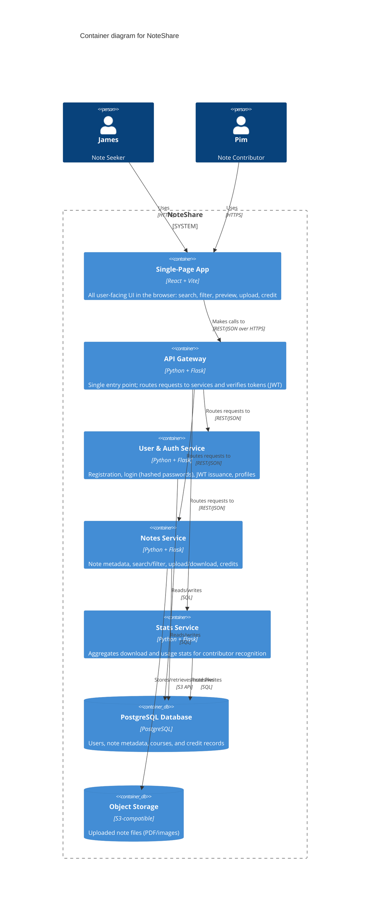

# C4 Level 2 — Containers (Mermaid Source)

ไฟล์นี้คือต้นฉบับ Mermaid ของแผนภาพ C4 Level 2 (Container) สำหรับ NoteShare ใช้คู่กับรูป PNG ใน [README.md](./README.md#c4-level-2--containers) container, เทคโนโลยี, และ responsibility ทั้งหมดตรงกับตารางใน README ทุกประการ

## Diagram

## Containers (อ้างอิงจาก README.md)

| Container | Tech | Responsibility |
| --- | --- | --- |
| Single-Page App | React + Vite | All user-facing UI in the browser: search, filter, preview, upload, credit |
| API Gateway | Python + Flask | Single entry point; routes requests to services and verifies tokens (JWT) |
| User & Auth Service | Python + Flask | Registration, login (hashed passwords), JWT issuance, profiles |
| Notes Service | Python + Flask | Note metadata, search/filter, upload/download, credits |
| Stats Service | Python + Flask | Aggregates download and usage stats for contributor recognition |
| PostgreSQL Database | PostgreSQL | Users, note metadata, courses, and credit records |
| Object Storage | S3-compatible | Uploaded note files (PDF/images) |

การเรียกทั้งหมดระหว่าง SPA → API Gateway → services เป็น REST/JSON over HTTP (รายละเอียดใน [ADR-002](./adr/0002-use-restful-api-internal-communication.md)) ส่วน service แต่ละตัวคุยกับ PostgreSQL ด้วย SQL ตรง ๆ และ Notes Service เป็นตัวที่ต่อกับ Object Storage สำหรับไฟล์โน้ตที่อัปโหลด/ดาวน์โหลด
