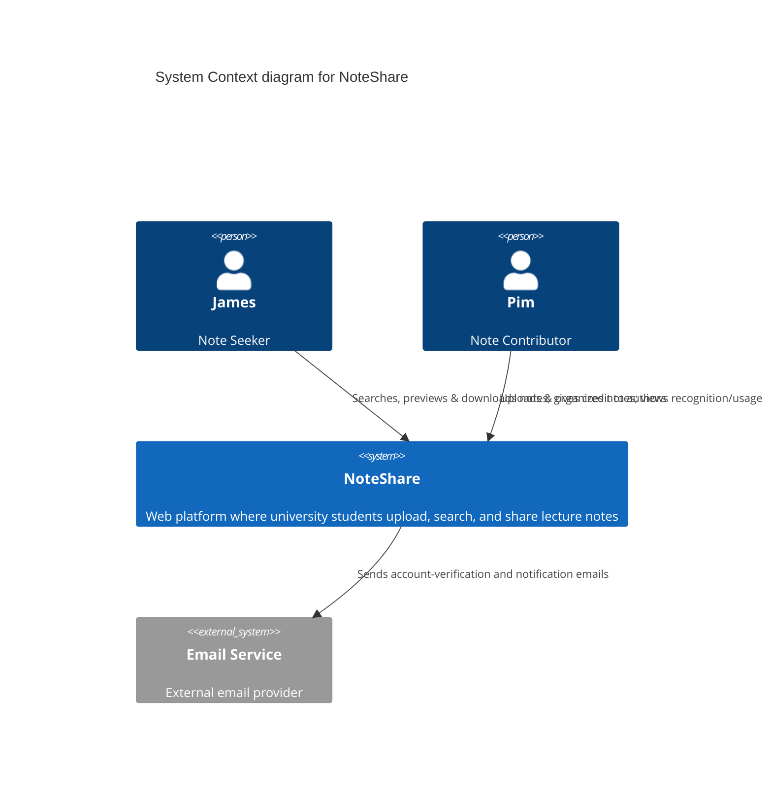

# 🏛️ C4 Level 1 — System Context (Mermaid Source)

ไฟล์นี้คือต้นฉบับ Mermaid ของแผนภาพ C4 Level 1 (System Context) สำหรับ NoteShare ใช้แทน/คู่กับรูป PNG ที่แสดงอยู่ใน [README.md](./README.md#c4-level-1--system-context) เนื้อหาของ entity และความสัมพันธ์ตรงกับตารางใน README ทุกประการ — ถ้าจะแก้ไขแผนภาพ ให้แก้ที่ไฟล์นี้ก่อน แล้วค่อยพิจารณาว่าจะ re-export เป็น SVG/PNG หรือไม่

## Diagram

## Relationships (อ้างอิงจาก README.md)

| Relationship | Description |
| --- | --- |
| James (Note Seeker) → NoteShare | Searches, previews & downloads notes; gives credit to authors |
| Pim (Note Contributor) → NoteShare | Uploads & organizes notes; views recognition/usage of her notes |
| NoteShare → Email Service | Sends account-verification and notification emails |

ตารางด้านบนเหมือนกับตารางในหัวข้อ "C4 Level 1 — System Context" ของ [README.md](./README.md) ทุกประการ ไม่ได้เพิ่ม entity หรือความสัมพันธ์ใหม่ — เป้าหมายของไฟล์นี้คือให้มี source ที่แก้ไขเป็น text/diff ได้ง่ายกว่าไฟล์ SVG
