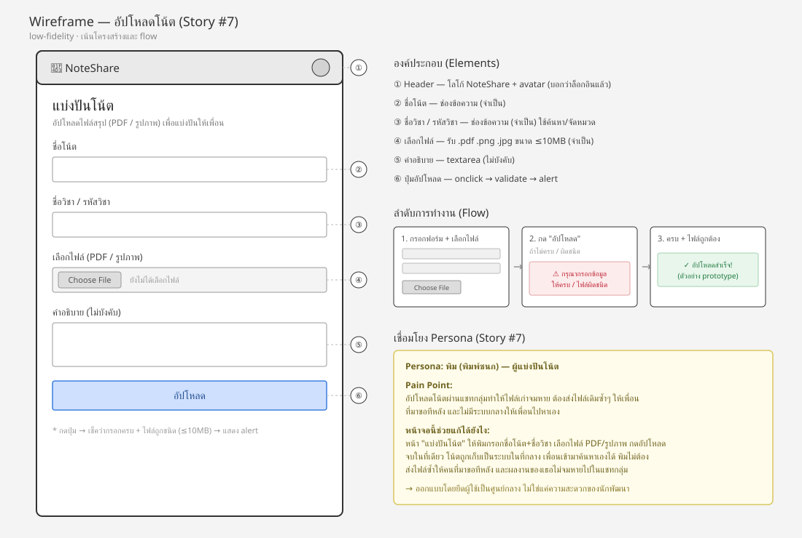
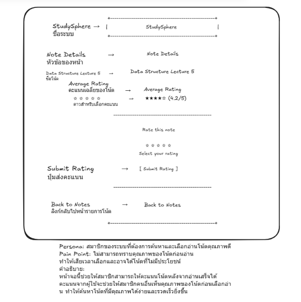
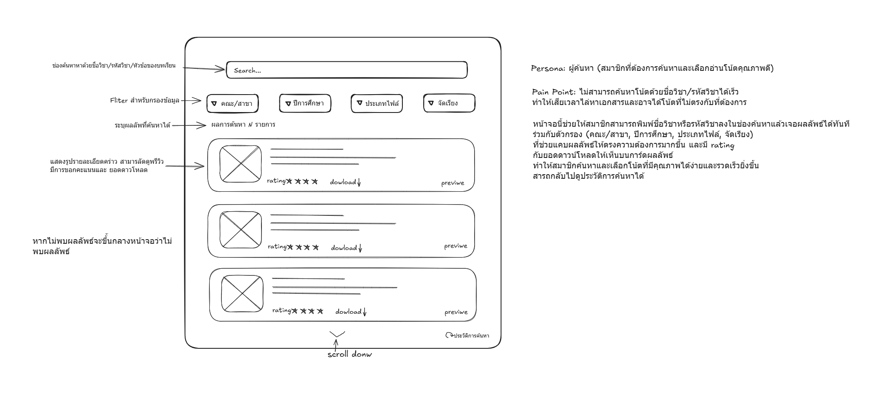

# Sprint 1 Prototypes

โฟลเดอร์นี้เก็บ interactive prototype 3 หน้าที่ทำใน Sprint 1 สำหรับ Lab 4 โดยแต่ละคนในทีมรับผิดชอบหนึ่ง flow

## 🧩 Prototype ไม่ใช่ Tracer Bullet

งานชิ้นนี้คือ **Prototype** ไม่ใช่ **Tracer Bullet** ทั้งสามหน้าเป็น front-end mockup ล้วน ๆ — HTML/CSS + vanilla JS ที่รันในเบราว์เซอร์ตรง ๆ ไม่มี backend จริงรองรับอยู่เบื้องหลัง ข้อมูลที่เห็น (รายการโน้ต, คะแนนเฉลี่ย, ผลค้นหา) เป็น mock/hardcoded อยู่ใน JS ทั้งหมด ไม่มีการเรียก API จริง

เหตุผลที่ยังทำ Tracer Bullet ไม่ได้: ตามที่ระบุใน [ADR-001](../../docs/architecture/adr/0001-tech-stack-selection.th.md) สถาปัตยกรรมที่วางไว้เป็น microservices หลายตัว (API Gateway, User & Auth, Notes, Stats) พร้อม PostgreSQL และ object storage แต่ตอนนี้มีแค่ `services/stats-service/` ที่เป็น scaffold เปล่า ๆ ส่วน service อื่นและฐานข้อมูลยังไม่ถูกสร้างขึ้นจริง Tracer Bullet ต้องเป็น slice บาง ๆ ที่วิ่งจริงผ่าน service ต่าง ๆ แบบ end-to-end ซึ่งยังทำไม่ได้ในสถานะปัจจุบันของโปรเจกต์ เป้าหมายของรอบนี้จึงเป็นการ validate UI/UX flow ก่อน ไม่ใช่ validate สถาปัตยกรรมจริง

## 📄 ขอบเขต (Scope)

| ไฟล์ | ผู้ทำ | แสดงอะไร |
| --- | --- | --- |
| `atichat_upload_note_prototype.html` | อติชาติ (PR #35) | flow อัปโหลดโน้ต — form กรอกชื่อโน้ต/วิชา, เลือกไฟล์ PDF หรือรูปภาพ, คำอธิบาย, validate ฝั่ง client (กรอกครบ + ชนิดไฟล์ถูกต้อง) ก่อนแจ้งว่า "อัปโหลดสำเร็จ" |
| `kittamet_note_rating_prototype.html` | กฤตเมธ (PR #36) | หน้ารายละเอียดโน้ต + ให้คะแนนแบบดาว (1-5) คลิกเลือกดาวแล้วกด submit เพื่อดู alert ยืนยัน |
| `wachirawit_search_note_prototype.html` | วชิรวิทย์ (PR #37) | หน้าค้นหาโน้ต — ค้นหาด้วยคำ, filter ตามคณะ/ปีการศึกษา/ประเภทไฟล์, sort (ล่าสุด/คะแนน/ยอดดาวน์โหลด), และ panel ประวัติการค้นหา |

**นอกขอบเขต (out of scope) ของรอบนี้:**
- ไม่มีระบบ auth จริง (ไม่มี login/session ใด ๆ)
- ไม่มีการอัปโหลด/เก็บไฟล์จริง — หน้าอัปโหลดแค่ validate แล้วแจ้งผลจำลอง ไม่มีไฟล์ถูกส่งไปไหน
- ข้อมูลโน้ต/คะแนนเฉลี่ยเป็นค่า hardcoded ในโค้ด ไม่มี state คงอยู่ข้าม reload (ยกเว้นประวัติการค้นหาของหน้า search ที่เก็บใน `localStorage` ของเบราว์เซอร์ เพื่อ demo UX เฉย ๆ ไม่ใช่ persistence ระดับ backend)

## 🖼️ หลักฐานภาพ

PR #35, #36, #37 ที่ merge ไปแล้วไม่มี screenshot/GIF แนบไว้ตอนรีวิว (แก้ย้อนหลังใน PR ที่ merge แล้วไม่ได้) จึงแปะภาพ wireframe ที่มีอยู่ในโฟลเดอร์นี้ไว้แทนเป็นหลักฐานเชิงภาพ

**อัปโหลดโน้ต (อติชาติ)**

**ให้คะแนนโน้ต (กฤตเมธ)**

**ค้นหาโน้ต (วชิรวิทย์)**

## ▶️ วิธีรัน

ไม่ต้อง build หรือรัน server ใด ๆ เปิดไฟล์ `.html` ตรง ๆ ในเบราว์เซอร์ได้เลย (ดับเบิลคลิก หรือ `start` ไฟล์จาก terminal) แต่ละไฟล์โหลด CSS ของตัวเองจากไฟล์ข้าง ๆ ในโฟลเดอร์เดียวกันอัตโนมัติ
